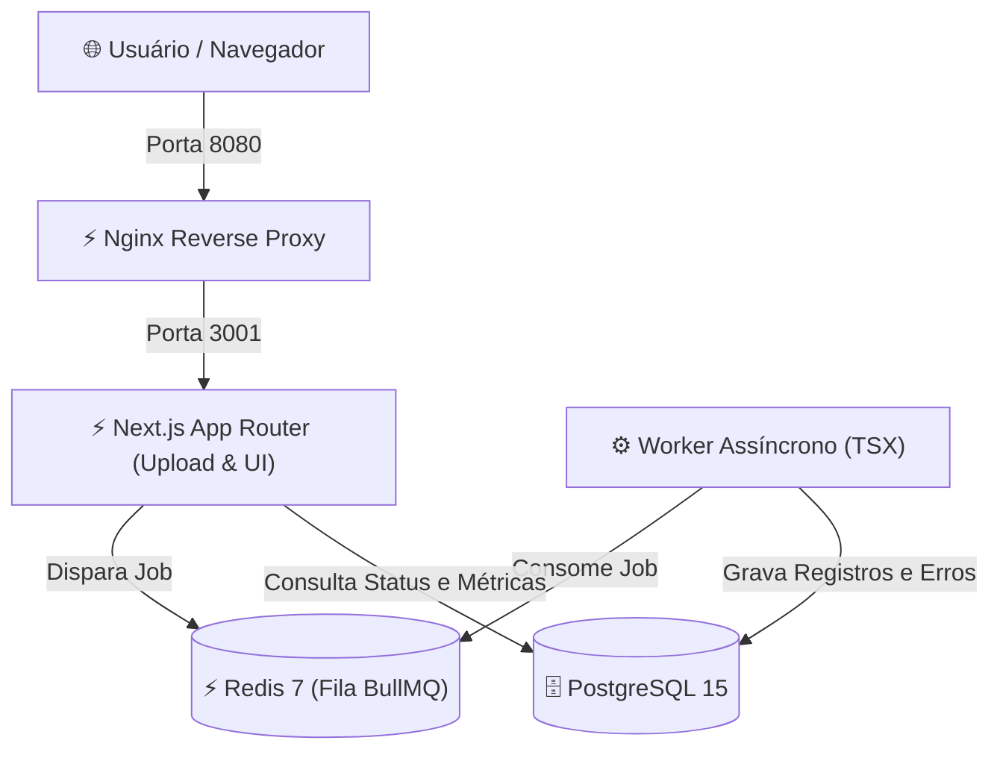

<div align="center">

# 📊 Sistema Inteligente de Importação e Gestão de Dados

<p align="center">
  
</p>

[](https://nextjs.org/)
[](https://www.typescriptlang.org/)
[](https://www.postgresql.org/)
[](https://redis.io/)
[](https://www.prisma.io/)
[](https://bullmq.io/)
[](https://www.docker.com/)
[](#)

<cite>Solução robusta e escalável para importação massiva e tratamento de dados em CSV e XLSX com processamento assíncrono em background, validação com Zod e observabilidade técnica em tempo real.</cite>

</div>

---

## 📌 Visão Geral

O **Import Data** é uma aplicação completa para ingestão de grandes volumes de dados tabulares. Utilizando a arquitetura moderna de filas e workers independentes, o sistema desacopla o upload de arquivos pesados da interface visual, assegurando que o usuário acompanhe o progresso das importações sem travamentos ou limites de requisição HTTP.

---

## 🏛️ Arquitetura da Solução



---

## ✨ Funcionalidades

- **Upload e Parsing Inteligente:** Leitura de arquivos `.csv` e `.xlsx` com detecção automática de delimitadores e mapeamento de cabeçalhos.
- **Processamento Assíncrono:** Fila de background gerenciada pelo BullMQ e Redis para ingestão sem congelamento da UI.
- **Relatórios de Auditoria & Erros:** Detecção de duplicidade de CPF, formatação de telefone e log minucioso de linhas rejeitadas.
- **Dashboard Analítico:** Gráficos de sucesso/falha, contadores de registros ativos e histórico de lotes processados.
- **Autenticação com 1 Clique:** Três perfis de demonstração pré-configurados sem necessidade de cadastro manual.

---

## 👥 Perfis de Acesso & Demonstração (1 Clique)

Na tela de login (`/login`), você pode se autenticar instantaneamente clicando em um dos perfis:

| Perfil | E-mail | Senha | Permissões |
|---|---|---|---|
| **Administrador** | `admin@importdata.com` | `Password@123` | Acesso total: usuários, reprocessamento de filas, auditoria e pessoas |
| **Gerente** | `gerente@importdata.com` | `Password@123` | Gestão de lotes de importação e edição de registros |
| **Operador** | `operador@importdata.com` | `Password@123` | Upload de arquivos e consulta de status de processamento |

---

## 🛠️ Tecnologias Utilizadas

- **Framework:** Next.js 16 (App Router)
- **Linguagem:** TypeScript 5.9
- **Estilização:** Tailwind CSS v4 & Next Themes
- **Banco de Dados:** PostgreSQL 15
- **ORM:** Prisma 5.22
- **Fila de Background:** BullMQ & Redis 7
- **Parser de Arquivos:** ExcelJS & Fast-CSV
- **Servidor Web:** Nginx 1.25 Alpine
- **Conteinerização:** Docker & Docker Compose v2

---

## 🚀 Como Executar

### 1. Clonar o Repositório
```bash
git clone https://github.com/omartins-zs/import-data-next-js.git
cd import-data-next-js
```

### 2. Execução com Docker (Recomendado)
```bash
# Configurar variáveis de ambiente
cp .env.example .env

# Subir a stack completa
docker compose up -d --build
```
Acesse [http://localhost:8080](http://localhost:8080).

### 3. Execução Local (Host)
Consulte as instruções detalhadas em [`docs/COMO_EXECUTAR_LOCAL.md`](file:///C:/Projetos/import-data-next-js/docs/COMO_EXECUTAR_LOCAL.md).

---

## 📚 Documentação Complementar

- [Acessos, Credenciais e Testes](file:///C:/Projetos/import-data-next-js/docs/ACESSOS_TESTES.md)
- [Como Executar - Visão Geral](file:///C:/Projetos/import-data-next-js/docs/COMO_EXECUTAR.md)
- [Como Executar Localmente](file:///C:/Projetos/import-data-next-js/docs/COMO_EXECUTAR_LOCAL.md)
- [Como Executar com Docker Compose](file:///C:/Projetos/import-data-next-js/docs/COMO_EXECUTAR_DOCKER.md)

---

<div align="center">

Feito com ❤️ por **[Gabriel Martins](https://github.com/omartins-zs)** 🚀

</div>
